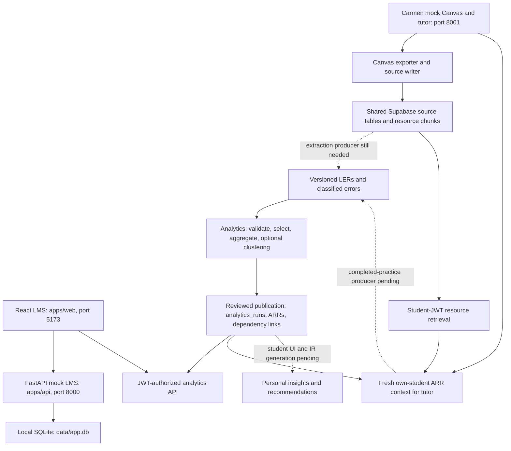

# Project state and implementation audit — 24 October 2026

This report compares implementation commit `b487459` with the user-supplied **Hackathon Learning Analytics Pipeline Specification**, version 1.0, dated 24 October 2026. That specification is the product baseline; the repository's analytics phase numbers and older LMS UI phase numbers describe different implementation sequences.

**Current position:** descriptive score analytics have processed the shared VIBE 101 evidence and published verified results to Supabase. Error statistics and reviewed semantic clustering are implemented downstream, but the live extraction/classification inputs are absent. The instructor analytics UI and authenticated tutor integration are implemented. The student insights experience, full OCR/extraction producer, completed-practice ingestion and automatic refresh remain unfinished.

“Implemented” below means code exists and has the stated test coverage. “Live verified” means the described operation was checked against the shared project. A simulated SDK test is not proof of deployed RLS, an actual provider response, or educational effectiveness.

## 1. Repository and shared-data state

The implementation changes were committed and pushed directly to `main` as `b487459` (`Integrate reviewed error clustering and authenticated tutor analytics`). This also pushed the previously local dashboard integration and merge commits. Real environment files, private run bundles, model caches and local databases remain ignored; they are deliberately outside the commit.

### Read-only live inventory

Course: **VIBE 101**, Canvas ID `1001`, Supabase course UUID `94c2f9d7-6940-463f-aa55-f09f66a35835`.

| Item | Verified count/state | Meaning |
|---|---:|---|
| Current / joined / contract-valid LERs | 555 / 555 / 555 | Existing evidence loads through the analytics boundary |
| Selected independent score observations | 551 | Selection applies eligibility, attempt and overlap rules |
| Selected outcome-mapped scores | 551 | Those selected observations have usable outcome mappings |
| Raw classified errors / error-evidence links | 0 / 0 | There is no actual error-classification handoff to analyze yet |
| Eligible error events / practice observations | 0 / 0 | No live error patterns or practice progress can be calculated |
| LERs missing `analytics_v1` metadata | 555 | Proposed completion/attribution metadata has not been supplied |
| Incomplete error-classification diagnostics | 553 | Unknown classification is not equivalent to no errors |
| Insufficient analyses / missing scores / whole-part overlaps | 4 / 2 / 2 | Diagnostics overlap; do not subtract their sum from 555 |
| Course enrollments / learner identity mappings | 0 / 0 | Real course-account access is blocked until provisioned |
| Resource chunks / chunks with embeddings | 99 / 0 | Text index exists; no populated vector index in this course |
| Persisted insight records / practice attempts | 0 / 0 | No stored IR or completed-practice loop exists for this course |

The published score run is `e8e7d69b-e580-4f76-9ccb-c6a0d69bbba9`:

- **163 ARRs:** 105 `student_outcome`, 7 `class_outcome`, 51 `assessment_question`.
- Run state is `complete`; all 163 result rows are nonstale; the current source fingerprint still matches the published source.
- Earlier publication verification checked exact typed document readback, all **27,750 dependency links**, and idempotent retry (`already_completed`).
- Earlier independent arithmetic verification checked all 105 student results and all 43 unsuppressed aggregate results, separately from production feature/statistics functions. Fifteen aggregate results were suppressed and insufficient; their hidden values were not exposed for inspection.
- No live `misconception_cluster` ARR has been published. The new review path was exercised with fictional data and simulated persistence.

This report's fresh live check read counts, readiness and publication freshness only. It made no database writes, changed no source grades or LERs, created no accounts and ran no migrations.

## 2. How the running pieces fit together



Existing live LERs are already present; the dotted extraction arrow means the inspected repository does not contain a complete producer for the richer error/OCR handoff. It does not mean the shared database is empty.

### Three identity/data systems must remain distinct

1. **Main LMS demo:** React/Vite plus FastAPI/SQLAlchemy, seeded courses and integer IDs, local SQLite. `apps/api/app/auth.py` accepts demo identity; this is a demo switcher, not shared-data authentication.
2. **Carmen mock Canvas:** separate FastAPI application under `carmen-study-guide/mock-canvas`, VIBE 101 fixtures, Canvas-shaped endpoints and the Study Tutor. Its local mock tokens do not grant Supabase access.
3. **Shared Supabase:** UUID course/learner IDs, Auth users, actual enrollments, `learner_identities`, RLS and pipeline records. Access requires the verified user's session. Integer mock course IDs are not Supabase UUIDs.

`apps/api/app/db.py` defaults to `data/app.db`; `init_db()` checks SQLite's schema version. `app.ingest.loader.rebuild()` drops and rebuilds the local schema from deterministic seed bundles and explicitly refuses non-SQLite engines before dropping tables. **Leave `DATABASE_URL` unset for this application; never point it at the shared database.**

Root `package.json` starts the API on 8000, Vite on 5173 and Carmen on 8001. The React instructor view talks to the analytics API. The separate Carmen tutor is at `/courses/1001/tutor` on port 8001; React's Learning Insights route is still a placeholder.

### Storage already available

The recorded Supabase schema includes these 35 public tables; table existence does not establish that a producer or UI exists:

| Area | Tables | Current implementation use |
|---|---|---|
| Identity | `profiles`, `courses`, `enrollments`, `learners`, `learner_identities` | Auth/course scoping; VIBE enrollments and identity mappings still empty |
| Knowledge | `outcomes`, `documents`, `resource_chunks`, `chunk_outcomes` | Source materials and search; no resource-vector population in VIBE |
| Assessments | `assessments`, `questions`, `question_answer_keys`, `question_outcomes`, `attempts`, `responses` | Source facts, question mappings and protected keys |
| Evidence | `evidence_refs`, `feedback`, `error_taxonomy`, `lers`, `ler_outcomes`, `ler_errors`, `ler_error_evidence`, `ler_evidence` | Existing LER reading; error producer still needed |
| Analytics | `analytics_runs`, `analytics_results`, `arr_ler_links` | Implemented run publication and lineage |
| Interpretations | `insight_records`, `ir_arr_links`, `ir_chunk_links` | Schema present; no complete generator found |
| Tutor/practice | `tutor_sessions`, `tutor_turns`, `practice_attempts` | Tutor session/turn logging exists; completed-practice path missing |
| Operations | `ingestion_jobs`, `extraction_revisions`, `audit_events` | Source ingestion jobs/audit exist; no general refresh worker |

See [supabase/README.md](../supabase/README.md) and its migration records for schema, RLS, storage buckets and lineage. These migrations are records of team-owned schema work, not a setup procedure to rerun. Repository SQL, particularly the latest search revision, should not be assumed deployed merely because its file exists.

## 3. Finished implementations and their exact execution paths

### 3.1 Mock LMS and normalized ingestion — workstream A / G

**Where:** `apps/api/app/ingest/`, `apps/api/app/models/`, `apps/api/app/routers/`, `apps/web/src/pages/`, and `carmen-study-guide/mock-canvas/{server.py,ingest.py,db_store.py}`.

**Main LMS path:** `CanvasJsonAdapter` reads Canvas-shaped seed exports; `ManualAdapter` applies explicit supplemental question/evidence data. Both produce the canonical bundle consumed by `loader.load()`, which resolves external identities into SQLite IDs and stores users, enrollments, assessments, question responses, rubrics, files and outcome mappings. FastAPI serves role-filtered course/submission/grade/file DTOs. React renders the actual seeded Home, Syllabus, Assignments, Quizzes, Grades and Files pages.

**Carmen export path:** `ingest.Canvas.get_all()` follows Canvas Link-header pagination, with timeouts and explicit optional-endpoint permission handling. `Exporter` collects course/outcome/module/document/assessment/submission facts; it saves original files and content hashes, uses HMAC-based stable pseudonyms, records source locators and represents missing source fields explicitly. Native PDF extraction uses `pypdf`; HTML is split into sections and slides/PDFs into page chunks with deep links.

**Shared source write path:** `db_store.Store.run()` creates an `ingestion_jobs` record, then invokes learners/documents/chunks/outcomes/assessments/questions/submissions/feedback steps. Stable source keys support upserts; document changes create a new version and hide old chunks. Quiz item responses become separate question/response rows; instructor quiz keys go into `question_answer_keys`, never into retrieval chunks. Rubric question parts can have their own rows, while whole-assignment facts remain explicitly `assignment_level`/`WHOLE`. Job completion and audit are recorded server-side.

**Actual completion boundary:** this path produces normalized source facts, not a complete OCR/classification/LER pipeline. Scanned pages with no text are flagged for OCR rather than invented. The Canvas adapter supports the mock contract; actual institution-specific Classic/New Quiz APIs and permissions remain unverified. It has pagination but no explicit 429/backoff retry loop.

### 3.2 Strict analytics input contracts and joined evidence loading — workstream D

**Where:** `app/analytics/{contracts.py,ler_adapter.py,evidence_repository.py,error_handoff.py}` under `apps/api`.

`SupabaseEvidenceRepository.load_course()` selects current LERs, joins the referenced learner, response, question, attempt, assessment or practice record, and fetches LER/outcome/error/evidence associations. Ordered pagination uses 500-row pages, with bounded ID-filter batches. It reads a whitelist of analytical facts and `payload.analytics_v1`, not unrestricted submission payloads or raw student prose.

Before an envelope is accepted, the loader checks course/learner/evidence ownership, referenced rows, positive usable outcome weights and explicit error attribution. Missing accepted-error evidence makes classification unusable; otherwise valid score evidence can survive. `adapt_ler()` converts each joined envelope into `AnalyticalInput`, retaining structured diagnostic codes. Strict Pydantic contracts reject unknown fields, invalid dimensions and nonfinite values; missing scores remain null.

Weights come from authoritative `question_outcomes.weight` or explicit metadata for an LER-specific mapping. Mapping confidence is not substituted for a weight. An error is not automatically assigned to every outcome of the question. Mapping provenance and `needs_review` are retained, but the feature builder does not automatically exclude every mapping marked for review; a stricter instructor-approval policy would need an explicit implementation and tests.

The proposed handoff namespace is:

```json
{
  "schema_version": "1.0",
  "errors_analyzed": true,
  "outcome_weights": {},
  "error_outcomes": {"actual-error-uuid": ["actual-outcome-uuid"]}
}
```

The UUID strings are illustrative placeholders. `errors_analyzed` is a strict JSON boolean or null. True plus an empty error list means classification completed without detected errors. False/null/missing means unknown, not clean. This flag is distinct from the LER's binary `analyzed|insufficient` semantic status and from a job's queued/failed technical status.

**Actual completion boundary:** the consumer, validation and fictional handoff are implemented. B must agree to this versioned namespace or supply an explicit alternative adapter and actually produce the facts.

### 3.3 Feature engineering and evidence selection — workstream D

**Where:** `app/analytics/features.py:build_features()` and `config.py:AnalyticsConfig`.

The feature builder creates separate observation, outcome, error, practice and exclusion tables:

1. Collapse exact duplicate LER IDs; quarantine conflicting copies instead of choosing by input order.
2. Exclude superseded LERs, semantically insufficient analyses and records outside the requested period. Periods use a half-open `[start,end)` interval.
3. Deduplicate logical student/question/attempt observations even when they have different LER IDs; quarantine conflicting duplicates.
4. Select latest valid independent graded score evidence per learner/question. Timestamp and attempt number resolve ordering; unresolved ordering is excluded explicitly.
5. Select error-classification evidence independently from score selection. Missing score does not automatically discard a genuinely classified error observation.
6. Prefer actual rubric question parts over overlapping whole-assessment observations, preventing double counting.
7. Normalize positive outcome weights per question; preserve original weights and score facts for provenance. Confidence values do not become weights.
8. Collapse repeated same-code tags within one observation; retain explicit outcome/evidence links. Rejected tags are excluded. Unreviewed tags follow the declared configuration policy.
9. Keep practice origin and assistance groups separate from independent graded scores.

The current default includes unreviewed error tags (`include_unreviewed_errors=True`); that is a declared analysis policy, not a claim of instructor endorsement. Text privacy approval and group meaning approval are additional requirements for live clustering publication.

### 3.4 Descriptive statistics — workstream D, live exercised

**Where:** `app/analytics/statistics.py:analyze_statistics()`, `_student()`, `_aggregate()`, `_outcome_errors()` and `_practice_summaries()`.

For learner `s` and outcome `o`, the score is:

`sum(selected earned_points × normalized outcome_weight) / sum(selected possible_points × normalized outcome_weight)`.

It is a ratio of weighted points, not an unweighted average of question percentages. Decimal accumulation limits numeric overflow. A student outcome needs at least **two distinct scored questions** by default; otherwise the ratio is null with an insufficiency flag.

Class aggregation first forms sufficient student ratios. It then computes both **equal-student mean** and **pooled weighted-points ratio**. They answer different questions and remain separate in storage and UI. Question aggregates require one valid question observation per student rather than the two-question outcome minimum. Coverage counts describe the observed evidence population; they do not claim coverage of every enrolled learner.

Error occurrence counts deduplicated eligible observations. Recurrence defaults to at least two occurrences. Outcome-specific prevalence uses **unique students with the category / unique independently assessed students with completed, usable error classification**. An unclassified student cannot silently count as error-free. Errors without explicit outcome attribution cannot establish an outcome's error absence.

Practice summaries retain independent/assisted/unknown groups, hint totals and known independent correctness. Ratios require at least two applicable attempts by default. These consumers exist even though no completed-practice producer is connected.

The default class minimum is **five students**. Small-cohort suppression removes sensitive aggregate values/counts/evidence links where applicable, not just the displayed percentage. The observed performance threshold is **0.70**, a descriptive rule. `mastery_estimate` remains null; no supervised mastery predictor or validated learning-effect estimate exists.

### 3.5 Local text embedding and clustering — workstream D, synthetic exercised

**Where:** `app/analytics/{text_preparation.py,embeddings.py,clustering.py,ml_readiness.py}`.

`prepare_error_texts()` accepts only explicitly approved short descriptions tied to eligible classified-error evidence. It verifies LER/code/reference relationships, uses one observation per LER/error category, normalizes whitespace/Unicode while preserving math and negation, and rejects unsupported inputs. It does not embed arbitrary answers or all feedback automatically.

`MiniLMOnnxEmbedder` executes the published `sentence-transformers/all-MiniLM-L6-v2` ONNX artifact locally on CPU at pinned revision `1110a243fdf4706b3f48f1d95db1a4f5529b4d41`. Token embeddings undergo attention-mask mean pooling and L2 normalization into **384 dimensions**. Model/tokenizer hashes and package versions enter provenance. Text beyond the supported 256-token limit is rejected instead of silently truncated. The in-memory hash-keyed embedding cache is bounded. Normal CLI use is local-cache-only, without an implicit model download or external text transmission.

`discover_misconceptions()` partitions by course, assessment origin and assistance. Each partition needs at least six distinct LERs. It computes cosine distances and applies DBSCAN with defaults `eps=0.25`, `min_samples=3`; a candidate must retain at least three distinct LERs. A 2,000-observation cap limits the explicit quadratic distance matrix. Noise remains unassigned. Representatives are actual medoid excerpts, not generated claims; outputs include distinct learner/question/evidence counts, pairwise similarity, assignments and silhouette only when defined.

These are **semantic similarity groups of existing classified descriptions**. This implementation neither learns error labels from grades nor proves a psychological misconception. Cluster IDs are run-local. Model/cache failures produce unavailable states without breaking score statistics. `ml_readiness()` checks inputs and cached model metadata without encoding text.

**Actual completion boundary:** two cached-model tests and an offline CLI run exercised the real embedder. Twenty fictional LERs supplied fifteen eligible descriptions and yielded two candidate groups. This demonstrates execution and integration, not semantic quality on actual VIBE feedback. No real course descriptions are available yet.

### 3.6 Revision-bound text approval and cluster meaning review — latest integration

**Where:** `app/analytics/reviewed_excerpts.py:ReviewedExcerptExport`, `cluster_review.py`, and their calls from `service.analyze_course()` / `persist_analysis()`.

There are two distinct review stages:

1. **Text review:** each export entry names the actual `ler_error_id`, LER ID and revision, code, brief description, source kind, evidence references and `privacy_reviewed=true`. The envelope records course, extraction/review version, reviewer reference and timestamp. Live validation checks the exact current error parent/code/status and actual error-evidence links. Obsolete, rejected and unrelated entries fail validation.
2. **Group review:** a candidate analysis emits an ignored private bundle and `.cluster-review.json` template. A reviewer examines membership and representatives, approves or rejects every group, and supplies attribution/time. A second analysis accepts the completed review and creates a finalized run containing only approved groups that satisfy publication cohort rules.

Review hashes bind source fingerprint, excerpt digest, model/runtime/configuration and membership; group keys stay stable across a new run UUID when analytical inputs stay the same. Input changes or pending decisions require renewed review. New live clustering publication revalidates the frozen report and ARR agreement and requires both review stages. The normal five-distinct-student suppression rule still applies to a published group.

Reviewer references and privacy flags are trusted operator attestations. They are not authenticated reviewer identity, an automatic privacy scanner or a review UI. A changed local export alone does not invalidate an already published database result; source corrections must create the appropriate LER revision.

### 3.7 Typed ARRs, provenance and controlled publication — workstream D, live exercised

**Where:** `app/analytics/{arr_generation.py,provenance.py,repository.py,service.py,cli.py}`.

`generate_arrs()` emits current **schema 1.1** documents for student outcomes, class outcomes, assessment questions and optional reviewed clusters. Per-run UUID5 IDs derive from dimensions, allowing retry of the same bundle without duplicate results. Documents include precise numerator/denominator definitions, inclusion rules, evidence sets, conservative dependency sets, configuration, input snapshot and interpretation limits.

`ARRDocument.database_row()` stores the complete typed document inside **`analytics_results.metrics.document`** alongside indexed row columns. For example, a student's ratio is at `metrics.document.metrics.observed_score_ratio`, not directly at `metrics.observed_score_ratio`. `document_from_row()` checks document/column agreement rather than trusting loosely shaped JSON. Older 1.0 contract scaffolding is not the current persistence format.

`analyze_course()` is read-only. It loads and validates inputs, builds statistics, optionally prepares/clusters text, freezes a restricted manifest, hashes source/config/normalized inputs/runtime versions and returns an `AnalysisBundle`. `--save-bundle` writes a private local file under ignored `data/analytics-runs/`; it does not publish.

`persist_analysis()` executes the controlled write path:

1. Require explicit exclusive-course-access attestation; reject offline fixture bundles and invalid/tampered bundles.
2. Preserve completed history; the identical completed bundle returns `already_completed`, while different content cannot reuse that run ID.
3. Compare current source fingerprint with the reviewed bundle.
4. Write run state `writing`, stage ARRs with `is_stale=true`, and write dependency links.
5. Read back and verify exact documents and links; recheck source fingerprint.
6. Set `publishing`, bulk-unhide the run's results, recheck source, then mark `complete`.
7. On failure, best-effort mark results stale and record safe failure state for retry.

This is several REST calls, **not a database transaction or an acquired lock**. Paused/serialized course writers are a prerequisite, not a guarantee implemented by a CLI flag. User-facing readers must enforce completed-run/source checks as well as result flags. A future transactional publication mechanism belongs with the database owner.

### 3.8 Authorized analytics API and instructor dashboard — workstream E / G

**Where:** `app/analytics/{access.py,dashboard.py}`, `app/routers/analytics.py`, `apps/web/src/api/{supabase.ts,client.ts,types.ts}`, `apps/web/src/pages/InstructorAnalytics.tsx`.

`analytics_session()` verifies bearer tokens with Supabase Auth; it does not decode and trust unsigned JWT claims. `course_membership()` checks real course enrollment and staff role. The shared endpoints are:

| Endpoint | Precise behavior |
|---|---|
| `GET /api/analytics/courses` | Discover the verified user's enrolled UUID courses |
| `GET /api/analytics/courses/{uuid}/summary` | Course staff only; return aggregate/question/reviewed-cluster DTOs |
| `GET /api/analytics/courses/{uuid}/my-results` | Resolve the caller's single learner identity; return only that learner's student-outcome results |
| `GET /api/analytics/courses/{uuid}/clusters/{arr_uuid}/evidence` | Staff only; verify current approved cluster and read supporting source refs with user JWT |

The older integer-course `/api/courses/{id}/analytics/summary` only applies the mock teacher guard and returns `supabase_sign_in_required`; it is not the shared analytics payload.

`load_dashboard()` discovers RLS-visible results before consulting private run metadata, chooses the newest visible run including stale rows, and refuses silent fallback to old results. `retrieve_current_results()` requires completed state and a matching live source fingerprint; a final result-ID/stale-flag check catches ordinary invalidation during reading. Private source manifests are not returned. Statuses distinguish ready, no results, stale, incomplete and insufficient evidence; HTTP errors distinguish invalid sessions, missing authorization and unavailable services.

React requires separate Supabase sign-in after the mock teacher gate. It stores the session in memory, sends the access token in Authorization headers, clears analytics queries on auth/demo identity changes, and uses random identity cache scopes instead of tokens in query keys. Course matching uses persisted Canvas IDs only when unambiguous, otherwise the user explicitly selects an enrolled shared course.

The dashboard displays mean-student versus pooled ratios, denominators, coverage, insufficiency/suppression, classified-error prevalence and approved group representative text. Staff evidence drill-down is lazy. Missing error summaries do not claim no mistakes. Student-specific rows are intentionally omitted from the instructor summary; the specified learner-by-outcome instructor matrix is still a future feature.

**Actual completion boundary:** API/UI implementation and simulated authorization tests pass. Live VIBE course accounts cannot currently see results because there are zero enrollments and learner identity mappings. The React student Learning Insights route still renders `PlaceholderPage` in `apps/web/src/App.tsx`.

### 3.9 Policy-controlled tutor, verified identity and ARR bridge — workstream F

**Where:** `carmen-study-guide/mock-canvas/tutor/{auth.py,policy.py,matcher.py,repo.py,service.py,verifier.py,analytics_bridge.py,llm.py,llm_ollama.py}`, plus `tutor_host.py` and `static/tutor.js`.

`tutor.auth.identity()` verifies a Supabase access token, resolves the Canvas course into a Supabase course, checks enrollment, maps the Auth user through `learner_identities`, and binds one learner to the request. A pseudonym or demo cookie cannot substitute. Even staff preview currently needs a mapped learner identity, because the session model binds a learner.

Carmen login uses server-side public-key Auth and sets an HttpOnly, SameSite Strict access-token cookie, Secure on HTTPS, expiring within one hour. Cookie-authenticated POSTs require a custom same-origin header and origin check; API bearer authentication also works. No password/token is returned in JSON. Logout clears the local cookie, not globally issued tokens. Refresh-token storage is not implemented. Provider clients may be cached; user clients and repositories are request-scoped.

`SupabaseTutorRepo` deliberately separates two clients:

- User JWT: assessment/outcome/session reads and `search_resource_chunks(p_student_safe=true)`.
- Server secret: session/turn writes, private answer-key checks and ARR source-freshness control reads. Session/course/learner ownership is checked before writes.

`analytics_bridge.weak_outcomes()` calls the same guarded schema 1.1 dashboard reader for the authenticated learner. It returns distinct sufficiently evidenced outcomes with observed score below 0.70. Stale/incomplete/null context supplies no boost. The tutor continues with ordinary authorized resources when analytics context is unavailable.

`TutorService.turn()` runs: validate own session/target/outcome → match referenced assessments → compute strictest assistance mode in code → retrieve at most six authorized chunks → load recent history/hint state → generate structured reply → verify → retry once if needed → use deterministic fallback if still unsafe/unavailable → write minimal session-turn/policy/citation logs.

`policy.mode_for()` defines protected, guided-homework and independent-study behavior from assessment policy/release state. Unknown statuses fail closed. `verifier.check_reply()` checks allowed moves, maximum hint level and one-step progression, citations from retrieved IDs, sufficiently long normalized answer-key fragments and other learner pseudonyms. Model-based paraphrase checking adds a separate backstop; it is not a mathematical guarantee of semantic grounding or cheating prevention. Staff preview has separate declared policy.

**Actual completion boundary:** these routes, provider adapters, rule fallback and fake-provider tests exist. This audit did not call a live LLM or write tutor sessions. Real user-session retrieval and provider acceptance remain pending. Generated practice conversation is not the implemented practice-to-LER loop.

### 3.10 Knowledge retrieval — workstream C, partial foundation

`ingest.Exporter.documents()` creates page/section chunks and original file references; `db_store.Store.chunks()` writes released/student-visible status and locator metadata. The SQL `search_resource_chunks` function is security invoker, course filtered, and supports full-text/vector reciprocal-rank fusion plus a matching-outcome boost. Its latest recorded revision ORs lexical terms to avoid requiring every word of a natural-language question.

**The current tutor passes `p_embedding=None`.** Thus its implemented request path is lexical retrieval with an optional boost for existing `chunk_outcomes`, regardless of the SQL's vector capability. VIBE has 99 chunks but zero stored embeddings. The inspected source writer does not create resource embeddings or chunk-outcome mappings. Strong semantic retrieval therefore needs both an index producer and query embedding path, plus verified outcome tagging.

Resource search expects **1536-dimensional** vectors; error clustering uses **384-dimensional MiniLM** vectors. These spaces serve different tasks and are not interchangeable. A retrieval upgrade must explicitly choose/version a compatible resource model or coordinate a schema change with the database owner.

## 4. Next implementation steps, with concrete definitions of done

### Priority 0 — Provision and verify real course identities

**Owner:** auth/database owner with application integration support.

Create the intended Auth accounts/profiles, `enrollments` with real staff/student roles and correct `learner_identities` pointing to existing course learners. This is identity provisioning, not a migration or arbitrary pseudonym matching. Staff tutor preview also needs the presently required learner mapping or a deliberately redesigned staff-session contract.

**Code path to exercise:** React sign-in → `/api/analytics/courses` → staff summary / student's `my-results`; Carmen sign-in → tutor context → user-JWT resource RPC. Never put test access tokens into committed scripts or chat.

**Done when:** instructor sees the current course aggregates; student A sees only A's results/session history; student B and anonymous tokens cannot read A's records or keys; student access to staff cluster evidence is denied. Run the actual RLS matrix against agreed fictional users. Existing simulated tests remain regression coverage, not substitutes.

### Priority 1 — Finish the evidence/error producer handoff

**Owner:** B/extraction, coordinated with A and D.

Implement or connect a producer after the normalized source export. Use native PDF text first, then OCR/vision for image-only pages; segment actual question responses and align instructor comments to stable question/attempt identities. Preserve original files, page/bounding-box locators and uncertainty. Assignment-level facts must remain assignment-level until actual question identity/evidence is available.

Write versioned `lers`, outcome/evidence links, genuine taxonomy entries in `ler_errors`, supporting `ler_error_evidence`, and the agreed completion/weight/attribution namespace. Use explicit completed-with-no-errors records as well as detected errors so prevalence denominators are meaningful. Distinguish operational failure from semantically insufficient evidence. Corrections insert a new LER revision; do not update an old LER in place.

**Downstream completion path already exists:** `load_course()` → `adapt_ler()` → `build_features()` → `analyze_statistics()`; no replacement statistics engine is needed.

**Done when:** one typed response and one annotated scan produce human-checked question/feedback/source matches; readiness has genuine classified observations and usable weights; hand-calculated error occurrence and unique-student denominators match ARRs. Establish taxonomy and mapping-review ownership before bulk production. Record OCR/alignment accuracy on a small hand-labeled set.

### Priority 2 — Run and evaluate clustering on actual reviewed descriptions

**Owner:** D plus an instructor/content reviewer; depends on priority 1.

Export revision-bound short descriptions into `ReviewedExcerptExport`. Review grounding/privacy first; install the optional clustering dependencies and cache the pinned model. Run clustering readiness, then candidate analysis. Review actual memberships/medoids against the original sources; approve/reject all groups; rerun with `--cluster-review` for the finalized bundle. Recheck source, review counts and publish with serialized course writers using the existing publication command.

**Done when:** genuine course descriptions pass ownership/revision checks, group members are semantically coherent, math/negation and near-opposite examples are not incorrectly merged, noise and cohort suppression are respected, and staff can trace a published reviewed group to its sources. A partition needs six distinct LERs; a candidate needs three; a displayed group normally needs five distinct students. Tune parameters only with an explicit development/evaluation split, not to force attractive groups.

This is optional enrichment in the specification. It should not delay deterministic error statistics, the student view or the first grounded recommendation.

### Priority 3 — Finish student insights and audience-specific IRs

**Owner:** E with D/C contracts.

Replace `App.tsx`'s Learning Insights placeholder with an authenticated student page consuming `/my-results`. Extend read-only evidence/resource DTOs with caller-scoped navigation from ARR → contributing LER → question/feedback/source. Start with deterministic interpretations of existing metrics and declared limits; fetch released outcome-linked resource chunks with the student's session.

Implement a distinct IR builder/service for student versus instructor audiences. Proposed outputs include explanation, allowed next action, ARR IDs, resource chunk IDs, generation version and limits. Decide explicitly between on-demand IRs and persisted `insight_records` plus `ir_arr_links` / `ir_chunk_links`; the specification permits either. If persisted, write server-side, validate every factual metric against ARRs, and honor invalidation.

Add the instructor's learner-by-outcome matrix only behind staff authorization; do not enlarge the audience of a student's personal IR. Suppress small cohorts and distinguish AI hypotheses from instructor feedback.

**Done when:** the worked vertical slice is visible: one actual question/feedback source → correct ARR → personal evidence-grounded explanation → exact released slide/page → safe tutor entry. A score change hides or regenerates the dependent interpretation. No generated percentage or mastery claim appears without a supporting metric.

### Priority 4 — Complete outcome-tagged resource indexing and citation QA

**Owner:** C.

Add an indexing job that verifies outcomes, writes `chunk_outcomes`, versions resource embeddings and preserves released permissions/deep links. Add matching query embeddings to `SupabaseTutorRepo.search()` only with the chosen compatible 1536-dimensional model. Lexical-only search remains a valid MVP fallback and should be evaluated before adding vector cost.

**Done when:** a small hand-labeled question set retrieves the expected authorized page in top-k, rendered citations land at that page, updated documents hide old chunks, and student queries cannot retrieve protected or unreleased material. Measure retrieval relevance separately from the fact that a citation ID was retrieved; the existing verifier does not establish semantic entailment.

### Priority 5 — Build completed-practice → LER → refresh

**Owner:** F/B/D/E together.

Implement a server-side practice-attempt endpoint/service validating session ownership, permitted practice item and submission. Write `practice_attempts`, then a grounded versioned practice-origin LER with answer/evaluation evidence, assistance level, hints used and known independent correctness. A tutor message alone is not a completed attempt. Keep graded, instructor-practice and generated-practice origin explicit.

Feed the new LER into the existing separate practice feature/statistics path and schedule an affected analytics/IR refresh. Define evaluator limitations and never grade an unreadable/ambiguous answer as certain.

**Done when:** a completed fictional practice attempt is persisted exactly once, reprocessing is idempotent, independent and assisted summaries differ correctly, a two-hint success does not inflate independent graded performance, and updated student insight remains source traceable.

### Priority 6 — Refresh orchestration, controlled demo and deployment

**Owner:** G plus database owner.

Connect source/extraction corrections to an idempotent per-course queue or worker. Serialize ingestion/metadata edits/publication; track queued/running/retry failures separately; compute a new run rather than overwrite completed history. Invalidate/rebuild IRs and notify the UI. Start with full-course recomputation for correctness, then narrow dependencies with measured regression coverage.

**Done when:** an isolated fictional grade or extraction correction marks affected results stale, produces a new complete run, updates authorized UI/tutor context and preserves the old run. Prepare one documented startup/fixture/auth/demo flow, provider-down fallback, and a real browser acceptance run across all three services.

## 5. Debugging runbook

### Establish the execution environment first

Use the API environment for `app.analytics` commands. Root scripts use each app's own virtual environment; installing packages into another Python interpreter can leave the app broken even when an isolated test environment passed.

From the repository root after creating virtual environments as described in README:

```powershell
& .\apps\api\.venv\Scripts\python.exe -m pip install -r apps/api/requirements-dev.txt -r apps/api/requirements-persistence.txt -r apps/api/requirements-clustering.txt
& .\carmen-study-guide\mock-canvas\.venv\Scripts\python.exe -m pip install -r carmen-study-guide/mock-canvas/requirements-dev.txt
npm --prefix apps/web install
npm run dev
```

Persistence and clustering are explicit optional requirements; root `npm run setup` alone is not the complete analytics installation. Private `.cache` tooling used for prior verification is machine-local, not a portable dependency lock or prerequisite to clone.

Canonical server settings are `SUPABASE_URL`, `SUPABASE_PUBLISHABLE_KEY`, `SUPABASE_SECRET_KEY` in `apps/api/.env`. The Vite browser file contains only `VITE_SUPABASE_URL` and `VITE_SUPABASE_PUBLISHABLE_KEY`; restart Vite after changes. Carmen accepts its documented server settings/legacy service-role alias and can borrow missing Supabase settings from `apps/api/.env` only when project URLs agree. Tutor provider settings belong to Carmen's server environment, not Vite. Check presence/configuration locally; never print secret values.

### Read-only analytics diagnostics

Run in `apps/api` with the intended interpreter:

```powershell
python -m app.analytics.cli courses
python -m app.analytics.cli readiness --course 94c2f9d7-6940-463f-aa55-f09f66a35835
python -m app.analytics.cli analyze --course 94c2f9d7-6940-463f-aa55-f09f66a35835 --save-bundle
```

The first two only read; the third reads and saves a private local bundle. Inspect the readiness summary and a hand-calculated sample before considering publication. Do not treat `analyze` output as a database write.

The fictional error/ML smoke test is independent of the shared data:

```powershell
python -m app.analytics.cli readiness --course 00000000-0000-4000-8000-000000000002 --input tests/analytics/fixtures/error_handoff.json --cluster --excerpts tests/analytics/fixtures/reviewed_errors.json --model-cache ../../.cache/analytics-models
python -m app.analytics.cli analyze --course 00000000-0000-4000-8000-000000000002 --input tests/analytics/fixtures/error_handoff.json --cluster --excerpts tests/analytics/fixtures/reviewed_errors.json --model-cache ../../.cache/analytics-models --save-bundle
```

It requires pre-cached model artifacts. With missing dependencies/cache, inspect the unavailable reason rather than inventing groups. Offline bundles cannot be published to the shared project. See [analytics-error-integration.md](analytics-error-integration.md) for completing the review template and rerunning with `--cluster-review`.

| Symptom | Exact path to inspect | Diagnostic and resolution |
|---|---|---|
| Mock pages work but analytics needs login | `access.analytics_session`, React `AnalyticsConnection` | Expected separate auth boundary. Demo teacher selection does not sign into Supabase. |
| Login succeeds, course list empty / 403 | `course_membership`, `tutor.auth.identity` | Check actual course `enrollments`; live VIBE currently has zero. Provision intended users/roles through the owner. |
| Student `my-results` 404 or tutor identity 403 | `dashboard_for(own=True)`, `tutor.auth.identity` | Exactly one correct `learner_identities` mapping is needed. Do not map by an arbitrary pseudonym. |
| No automatic course match | React `ConnectedResults` | SQLite IDs and Canvas/Supabase IDs differ. Select an enrolled UUID course; only use persisted unambiguous `canvas_id` matches. |
| 401 after tutor worked | `tutor.auth.login/identity` | Cookie/token expired; reauthenticate. Current cookie flow has no refresh-token lifecycle. |
| Cookie POST gets 403 | `same_origin`, `static/tutor.js` | Inspect Origin, `X-Tutor-Request: 1`, actual host/protocol and proxy configuration. Do not remove the ownership/auth checks. |
| API gives 503 | `supabase_clients._required`, `access.control_repository`, optional imports | Verify the running interpreter, server settings and persistence dependencies. HTTP deliberately hides raw upstream errors. Reproduce with the safe CLI summary. |
| Source store says key missing but tutor connects | `db_store.configured` vs `supabase_client._env` | Confirmed code inconsistency: the store preflight reads only process env; the shared helper also reads API-file fallback. `YOUR-SECRET-KEY` is also not filtered by the preflight. Configure the correct Carmen server env for now; unify the resolver in a follow-up. |
| Scores exist but no errors/groups | `load_course`, `completion_metadata`, `ml_readiness` | VIBE has zero error rows/links and missing completion metadata. Fix B's producer; a model installation cannot supply missing facts. |
| Error prevalence smaller/larger than expected | `_outcome_errors`, `_aggregate` | Reconcile distinct eligible learners, explicit error attribution, completed classification, attempt choice and suppression. Total enrollment is not this denominator. |
| Score differs from a naive spreadsheet mean | `build_features`, `_student`, `_aggregate` | Match latest-valid attempts, normalized per-question weights, excluded WHOLE overlap, point-ratio formula and cohort minimum. Compare mean-student and pooled ratios separately. |
| Null ratio or suppressed counts | `AnalyticsConfig`, `_student`, `_aggregate` | Two distinct scored questions for a student outcome and five students for class reporting are defaults. Missing/insufficient is not zero. |
| ML unavailable / no candidates | `MiniLMOnnxEmbedder._load`, `ml_readiness`, `discover_misconceptions` | Check optional requirements, pinned local cache, accepted descriptions, six-distinct-LER partition minimum and 2,000-row cap. A completed all-noise result can be valid. |
| Model rejects description | `ApprovedErrorText`, `prepare_error_texts`, `encode` | Check explicit privacy approval, supported current source refs, 1,000-character text limit and 256-token model limit. Shorten with review; do not silently truncate. |
| Review is stale/pending | `cluster_review.approved_ids`, `ReviewedExcerptExport.approved_inputs` | Source/revision/model/config/membership changed or decisions remain pending. Regenerate/review; do not hand-edit binding hashes. |
| Dashboard returns stale/incomplete | `load_dashboard`, `retrieve_current_results`, run params | Check newest visible run status, `is_stale` flags and live fingerprint. Regenerate from current source and publish properly; do not force flags clear or fall back invisibly. |
| Publish refuses an offline bundle or active writers | `persist_analysis`, CLI `publish` | Expected preconditions. Use a reviewed live-source bundle and serialize all course writers; the attestation is not a lock. |
| Cluster evidence 403/404/409 | `routers.analytics.cluster_evidence` | Respect staff scope, same-course ARR identity, current reviewed group and run freshness. A stale group must be reanalyzed. |
| Tutor ignores weak-outcome context | `analytics_bridge.weak_outcomes` | Need own current complete schema 1.1 results, sufficient questions, nonnull ratio below .70. Absence of a boost is deliberate when these fail. |
| Tutor gets no useful sources | `repo.search`, RPC, `Store.chunks` | Current request is lexical; inspect searchable terms, released visibility, course ID, locators and outcome links. Check deployment of the recorded search revision with the owner. |
| Tutor repeatedly falls back | `TutorService.turn`, verifier, provider adapter | Check model readiness, response schema, citation IDs, mode/hint violations and answer checks using fictional inputs. Distinguish provider outage from rejected unsafe output. |
| SQLite rebuild fails / wrong database selected | `app/db.py`, `loader.rebuild` | Leave `DATABASE_URL` unset and use local SQLite. Never use a Supabase URL or migration/reset as a repair step. |

### Reproduce regression checks

With persistence/clustering/dev requirements installed, from `apps/api`:

```powershell
$env:ANALYTICS_MODEL_CACHE = (Resolve-Path '../../.cache/analytics-models').Path
python -m pytest tests -q -p no:cacheprovider
```

If the model cache is absent, omit that environment setting and explicitly report skipped cached-model tests; a skip does not verify embedding inference.

From `carmen-study-guide/mock-canvas`:

```powershell
python -m pytest tutor/tests tests/test_part_g.py --ignore=tutor/tests/test_repo_live.py --ignore=tutor/tests/test_service_live.py -q -p no:cacheprovider
```

From `apps/web`:

```powershell
npm test -- --reporter=dot
npm run build
```

Tutor live tests require deliberately supplied private credentials/user access token and may write/delete test sessions. Keep them outside routine regression runs. This audit did not run them or a browser E2E session.

## 6. Suggested improvements, with proposed implementation mechanics

These are recommendations, not claims that the work is already complete.

| Priority | Improvement | Technical completion approach | Acceptance evidence |
|---|---|---|---|
| High | One reliable student/instructor vertical slice | Finish identity provisioning and typed/scanned error handoff; render personal ARR→source→resource→tutor before broadening features | A recorded fictional user flow plus actual A/B role-isolation checks |
| High | Shared configuration resolution | Replace `db_store.configured()`'s duplicate environment test with a common safe resolver used by both clients/preflight; consistently reject placeholders and wrong-project fallback | Tests for API-only fallback, Carmen overrides, both placeholder forms and cross-project rejection |
| High | Reproducible app environments and CI | Define a documented full analytics install/test extra or aggregate requirements and lock compatible versions; run API, non-live Carmen and web suites in CI; require cached-model job explicitly | Clean checkout installs in intended environments; no accidentally skipped analytics suite; build/tests reproducible |
| High | Transactional publication and automatic serialization | Coordinate owner-managed SQL/RPC or an explicit per-course lock/queue; atomically verify expected source version and publish results/links/run state | Concurrent writer test, failure injection and no visible partial run; retain idempotent history |
| High | Actual retrieval and tutor quality evaluation | Hand-label expected pages, restricted-item paraphrases and citation support; compare lexical baseline with a compatible vector model; audit authorized file links | Top-k/citation relevance and policy-bypass measurements, not just valid citation IDs |
| Medium | Authenticated review workflow | Build staff-only review endpoints/UI over candidate manifests; record verified reviewer identity and versioned decisions server-side; preserve source/text binding | Review cannot be attributed by editing a free-form local string; changed source forces renewal |
| Medium | More precise lineage and cheaper freshness checks | Current broad course dependencies and full-course fingerprint reads favor correctness but create 27,750 links for 163 ARRs. After coverage tests, use explicit per-scope dependencies and an owner-managed monotonic source version | Same invalidation correctness with fewer links/queries; benchmark read latency and source-change races |
| Medium | Course refresh worker | Queue corrected LERs/grades, serialize course updates, retry idempotently, create new ARRs, invalidate/regenerate IRs | Isolated correction automatically reaches UI/tutor without losing history |
| Medium | Search/index lifecycle | Produce reviewed chunk-outcome links and versioned compatible embeddings, add reindex checkpoints and retain keyword fallback | New/revised docs indexed once; old versions invisible; query/index model dimensions agree |
| Medium | Tutor session lifecycle and operational controls | Add deliberate refresh/relogin UX, staff-session design, proxy-aware HTTPS/origin deployment config and shared bounded rate-limit storage | Expiry/relogin, multi-worker limits and account-switch tests pass without token/session leakage |
| Medium | Safe structured operational diagnostics | Log safe job/run IDs and failure codes, timings and exclusion counts. Review exception logging in remaining matcher/leak-check paths and source-job raw error storage | Failure can be diagnosed without storing raw prompts, provider payloads or credential-bearing exceptions |
| Medium | Smaller frontend initial bundle | Lazy-load large analytics/InstUI routes where useful; measure rather than guess at manual chunks | Production chunk sizes/load performance improve while auth-cache reset tests stay green |
| Later | Validated trends or predictive mastery | Add explicit time-window comparability, adequate labeled history and held-out calibration/evaluation before adding a mastery model | Declared metrics/timing/no-leakage evaluation; never relabel observed score as mastery |

Keep privacy suppression and missing-data semantics while improving UI. Lowering evidence thresholds or marking unknown classifications complete solely to populate a dashboard would change the meaning of the analysis.

## 7. What the tests establish, and what they still do not

The last complete implementation verification on this code state passed:

- **277 API tests**, including feature selection, known-answer statistics, persistence/retry/freshness, authorization DTOs and error/review integration. Both cached MiniLM tests ran.
- **75 non-live Carmen/tutor tests**, covering policy, matcher, verifier, provider adapters with fakes, session ownership, authenticated boundary and source-contract integration.
- **24 frontend tests**, including real static tutor-script behavior through DOM tests, sign-in/out, auth/cache transitions, staff results/evidence rendering and placeholder/null/stale behavior.
- TypeScript/Vite production build and tutor JavaScript syntax check.
- Offline real-model CLI smoke run: 20 fictional LERs, 15 descriptions, two candidate groups, private bundle/template, no publication.

The production build reported the existing large-chunk warning (approximately 833 kB minified / 240 kB gzip). Supabase SDK deprecation warnings were nonfatal. Neither is evidence of a failed analytics computation.

`apps/api/tests/analytics/test_error_integration.py` explicitly checks strict completion, manual classified-error denominators, obsolete/unrelated review rejection, changed-input review invalidation, approved/rejected groups, report tampering, staff evidence and stale tutor context. Its publication client is simulated. `tutor/tests/test_auth_boundary.py` verifies client separation, no demo fallback, correct mapping, session/course denial, cookie/origin behavior and project-safe configuration fallback. Live RLS acceptance must still be performed after accounts exist.

Still pending from specification §15:

- A typed document **and annotated scanned page** through an actual extraction producer with correct source coordinates.
- Actual instructor and two-student JWT/RLS checks, authorized deep-link/file access and full browser flows.
- Real course description clustering quality and review, rather than fixed synthetic examples.
- Provider-backed tutor response/citation and direct/paraphrased protected-answer evaluation.
- A real completed practice attempt producing a new LER and an affected analytics/IR refresh.
- Correction-triggered end-to-end regeneration, not merely stale detection or simulated invalidation.
- Evidence-grounded student and instructor recommendations with explicit IR source chains.

The schema owner's historical RLS/lineage verification in `supabase/README.md` is useful evidence for that schema. It is distinct from this implementation's simulated tests and from currently unperformed user-session integration acceptance.

## 8. Specification alignment and immediate handoff

| Specification | Current status | Remaining task |
|---|---|---|
| §§3–4, A/B: authorized sources and scanned evidence | Source adapters, original storage, hashes, locators and native PDF extraction exist | Institution-specific Canvas acceptance; OCR/vision alignment and complete LER/error producer |
| §5, C: course resource index | Page/section chunks, permission-aware RPC and lexical tutor path | Verified outcome links, vector/query producer if selected, relevance/citation QA |
| §§6–7: LER storage/versioning | Shared tables/triggers; strict reader and error contract | Upstream production/review workflow and automatic recomputation orchestration |
| §8, D: deterministic analytics | Implemented, independently checked and live published | Supply genuine classified error/practice inputs; evaluate optional clusters |
| §9, ARR | Typed schema 1.1, provenance, lineage, guarded publication/readback | Transaction/locking improvement; longitudinal computation not implemented |
| §10, IR | Tables and baseline display limits exist | Audience-specific generator, source/resource links and invalidation integration |
| §11, F: tutor | Policy, authorized retrieval, verification, logs, own-ARR bridge exist | Live user/provider acceptance, stronger evaluation and completed-practice loop |
| §12, E: dashboards | Instructor aggregates/error/group UI implemented; own-results API ready | Student page/IRs, staff learner matrix, instructional recommendations and richer source navigation |
| §13: APIs/orchestration | Read APIs, CLI dry-run/publish, ingestion job records and tutor routes | Extract/practice/refresh services or equivalent orchestrated jobs |
| §§14–15, G: governance/QA | Secret/client separation, RLS-aware reads, suppression, broad tests | Actual role matrix, retention/provider policy decisions, scan/citation/demo acceptance |

**Recommended next milestone:** provision the three intended demo identities and finish one real, human-checked question/feedback/error handoff. Then render its deterministic personal insight with a released source page and safe tutor entry. Extend that verified slice to recurring error prevalence and reviewed clustering, followed by the practice/refresh loop. The score engine and database tables can be reused; missing producers and user-facing evidence chains are the work now.

Related operational documents: [analytics contract](analytics-contract.md), [persistence](analytics-persistence.md), [dashboard acceptance](analytics-dashboard.md), [error/review integration](analytics-error-integration.md), [clustering integration plan](analytics-clustering-integration-plan.md), [roadmap](analytics-roadmap.md), [source export contract](../carmen-study-guide/mock-canvas/INGEST_CONTRACT.md).
